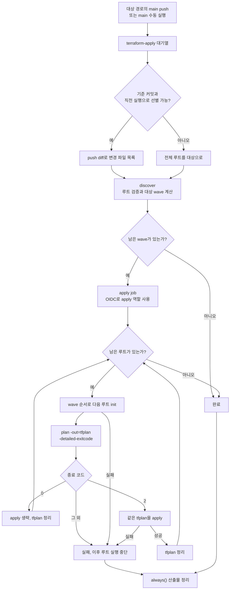

# Main apply

실행 정의는 [terraform-apply.yml](https://github.com/kintoun-secops/kintoun-infra/blob/main/.github/workflows/terraform-apply.yml)에 있다.
PR의 plan 파일을 재사용하지 않고 main 코드로 새 plan을 만든 뒤 같은 러너에서 적용한다.
PR의 `_tf-root.yml`에는 plan job만 있으며 main 적용은 이 문서의 별도 워크플로에서 수행한다.

## 실행 흐름

`discover`가 실패하면 apply job을 실행하지 않는다. 취소된 실행도 마지막 정리 스텝의 대상이다.

## apply 대상 선별

`discover`는 push의 이전 커밋(`github.event.before`)과 비교한 변경 파일 목록을
`tf-targets.js --mode apply`에 넣어 apply 할 루트를 고른다. 선별 규칙은 PR의 plan 대상 선별과 같고
모드에 따라 전체 대상 경로와 제외 경로만 다르다([plan 대상 선별](plan.md#plan-대상-선별)).

| 조건 | 대상 |
| --- | --- |
| 수동 실행 | 전체 루트 |
| 기준 커밋이 저장소에 없음 (force push 등) | 전체 루트 |
| 직전 apply 실행이 `success`가 아님 | 전체 루트 |
| 그 외 push | 변경 영향이 있는 루트 |

직전 실행이 실패하거나 취소되면 그 커밋의 변경은 적용되지 않은 상태로 남는다. 이번 push의 diff에는
그 파일이 없으므로 선별을 포기하고 전체 루트를 대상으로 되돌린다. 실행 결과 조회에는 `actions: read`를 쓴다.

선별 결과는 `tf-roots.js`가 계산한 wave에서 대상이 아닌 루트를 빼는 데 쓴다. wave 안의 순서와 wave
사이의 선후는 그대로 두고 빈 wave만 버린다. 남은 wave가 없으면 apply job을 건너뛴다.
선별한 루트와 생략한 루트는 `discover`의 job 요약에 표로 남는다.

## 적용과 재실행

`terraform-apply.yml`은 main push와 수동 실행을 지원한다.
`tf-roots.js`가 `depends_on` 그래프의 깊이를 계산하고, apply job이 결과 배열을 반복하며
모든 wave를 순서대로 실행한다. 같은 wave의 루트는 한 job 안에서 차례로 적용한다.

각 루트는 같은 러너에서 `plan -detailed-exitcode -out=tfplan`을 실행한다.

| 종료 코드 | 처리 |
| --- | --- |
| `0` | 변경 없음, apply 생략 |
| `2` | 생성한 `tfplan`을 apply |
| 그 외 | 실패 |

워크플로의 `queue: max`가 최대 100개 실행을 대기시킨다. 한 실행 안에서는 루트별
plan과 apply가 연속으로 실행된다. 대기열은 대기 시작 시각의 FIFO이며 커밋 순서를
보장하지는 않는다([GitHub concurrency 안내](https://docs.github.com/en/actions/how-tos/write-workflows/choose-when-workflows-run/control-workflow-concurrency)).
문서처럼 `paths-ignore`에 해당하는 파일만 머지하면 자동 apply는 실행하지 않는다.
변경 영향이 없는 루트는 `init`과 `plan`까지 생략하므로 그 루트의 드리프트는 자동 apply로 교정되지 않는다.
드리프트 교정은 전체 루트를 돌리는 수동 실행으로 수행한다.
어느 루트에서든 init, plan 또는 apply가 실패하면 뒤의 루트와 wave는 실행하지 않는다.
plan 파일은 실패나 취소 시에도 정리한다.

수동 재실행은 Actions → terraform apply → Run workflow에서 **main**을 선택한다.
apply 역할의 OIDC trust가 main subject만 허용한다.

wave 계산과 새 루트 등록은 [저장소 구조](../structure.md#apply-순서-계산)를 참고한다.
PR에서는 [apply 순서 코멘트](plan.md#apply-순서-코멘트)로 의존성 변경을 확인한다.
PR이 변경 영향이 없는 루트의 plan을 생략하는 기준은 [plan 대상 선별](plan.md#plan-대상-선별)에 있다.
